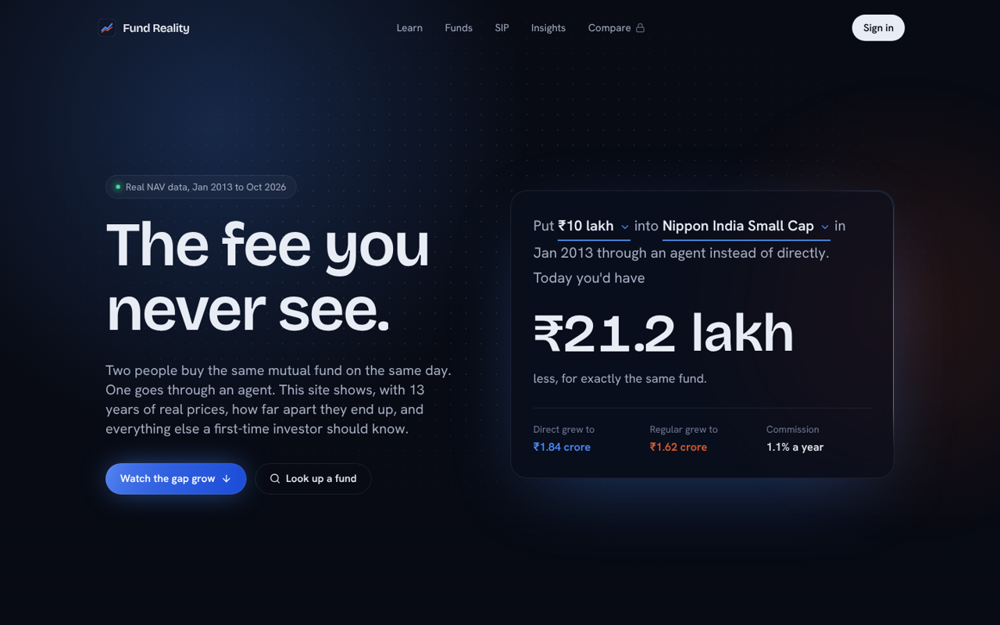

# Fund Reality

**Indian mutual funds, explained with 13 years of real data.** It shows what the Regular plan really costs, what a typical investor actually earned, and how far funds can fall, written for people who are new to investing.

**Live site:** https://mf-reality-check-ndx1.vercel.app



## What the data shows

Built on daily NAVs for 21 well-known funds (both Direct and Regular plans), January 2013 to October 2026.

- **The Regular plan is expensive.** ₹10 lakh invested in January 2013 through an agent instead of directly ended up **₹9.9 lakh smaller on average**, and **₹21.2 lakh smaller** in Nippon India Small Cap. Same fund, same holdings; the only difference is the commission.
- **When you measure changes the answer.** The Nifty 50 index fund returned 5.8% a year over the last 5 years, but the typical 5-year period since 2013 earned 13.3%. The latest period started near a market high.
- **No kind of equity fund escaped the 2020 crash.** Average worst falls ranged from −35% (mid caps) to −43% (small caps).
- **Popular funds look better than funds in general.** These large-cap funds beat the index in 71% of 5-year periods, yet S&P's SPIVA India scorecard found 84% of *all* large-cap funds lagged their benchmark over 5 years. That gap is selection and survivorship bias, and the site explains it.

## Features

**For everyone**
- **Home:** an interactive "what did the agent cost?" calculator, plus a scroll-driven story where the Direct and Regular lines draw themselves and the gap grows.
- **Learn:** NAV, Direct vs Regular, index funds, SIP, CAGR, rolling returns and drawdown, each paired with a live chart of real data.
- **Funds:** a searchable, filterable directory and a page for every fund, with growth vs the Nifty 50, every 5-year window, falls from the peak, and the Regular-plan cost.
- **SIP simulator:** monthly investing replayed on real historical NAVs, with XIRR, compared against the index fund.
- **Insights:** timing, risk by fund type, and the survivorship-bias catch.

**For signed-in members** (Supabase auth)
- **Portfolio cost check:** add the funds you hold and see what Regular plans have cost you so far, plus a 10-year estimate.
- **Watchlist**, **saved SIP plans**, and **compare up to 3 funds** on one chart and table.

## How it works

```
mfapi.in (AMFI NAVs)
   │  Python: find scheme codes, download full NAV history
   ▼
pandas cleaning: parse dates/NAVs, sort, fill weekends and holidays
   │  DuckDB (SQL): health checks, category scoreboard
   ▼
Metrics: CAGR, rolling 3y/5y returns, beat-the-index rate,
         max drawdown, volatility, SIP XIRR, Direct-vs-Regular cost
   │  exported as JSON  →  public/data/
   ▼
Next.js site: static pages built from the JSON, charts in ECharts,
              member data in Supabase (Postgres + row-level security)
```

## Tech stack

| Area | Tools |
| --- | --- |
| Data analysis | Python, pandas, NumPy, DuckDB (SQL) |
| Frontend | Next.js 14 (App Router), React, TypeScript, Tailwind CSS |
| Motion | Framer Motion, Lenis smooth scroll |
| Charts | Apache ECharts, custom SVG |
| Auth and database | Supabase (email sign-in, optional Google; Postgres with row-level security) |
| Hosting | Vercel |

## Run it locally

```bash
npm install
npm run dev        # http://localhost:3000
```

The fund data is already in `public/data`, so the site runs straight away. Sign-in and member pages need a Supabase project: see [SETUP.md](SETUP.md).

### Environment variables

| Name | Value |
| --- | --- |
| `NEXT_PUBLIC_SUPABASE_URL` or `SUPABASE_URL` | `https://<project>.supabase.co` |
| `NEXT_PUBLIC_SUPABASE_ANON_KEY` or `SUPABASE_ANON_KEY` | the project's publishable (anon) key |

Put them in `.env.local` for local development, and in the project's Environment Variables on Vercel. Without them the site still works, with member features switched off.

## Project structure

```
src/
├── app/                 pages: home, learn, funds/[slug], sip, insights,
│                        compare, dashboard, login, auth/callback
├── components/
│   ├── motion/          reusable animations (odometer, split text, scroll reveal…)
│   ├── charts/          ECharts wrapper, sparklines, small SVG charts
│   └── home/ learn/ funds/ sip/ insights/ members/ site/
├── lib/                 data loading, finance maths (XIRR, SIP), formatting, Supabase
└── middleware.ts        refreshes sessions, protects member pages
public/data/             analysis output (summary, categories, per-fund weekly series)
supabase/schema.sql      tables + row-level security policies
```

## Method and limitations

- Everything starts in **January 2013**, when Direct plans were introduced, so both plans are compared over the same years.
- Rolling returns use every possible start date. Charts use weekly points; headline metrics use daily data.
- **Selection bias:** the funds were chosen because they're well known today.
- **Survivorship bias:** funds that were closed or merged are missing.
- Mid- and small-cap funds are compared with a Nifty 50 index fund, which mostly measures company size rather than manager skill.
- Returns ignore taxes and exit loads.

## Credits

- NAV data: [mfapi.in](https://www.mfapi.in), which republishes AMFI data.
- Benchmark study: [S&P SPIVA India Year-End 2025](https://www.spglobal.com/spdji/en/spiva/article/spiva-india-year-end-2025/).
- Motion patterns inspired by [Aceternity UI](https://ui.aceternity.com), [Magic UI](https://magicui.design), [React Bits](https://reactbits.dev) and [21st.dev](https://21st.dev), re-implemented with Framer Motion (see [SETUP.md](SETUP.md) for the full list).

---

*A learning project, not investment advice. Past returns don't predict future returns.*
